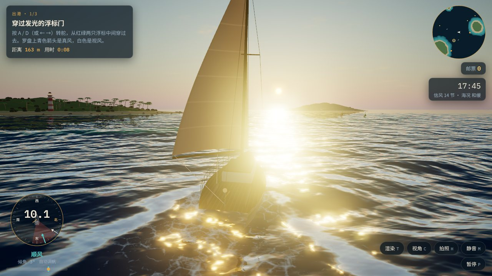
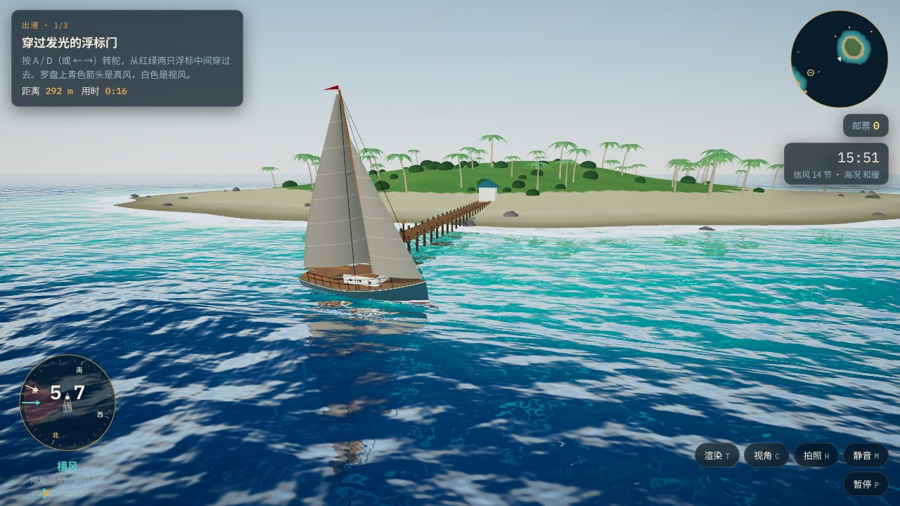
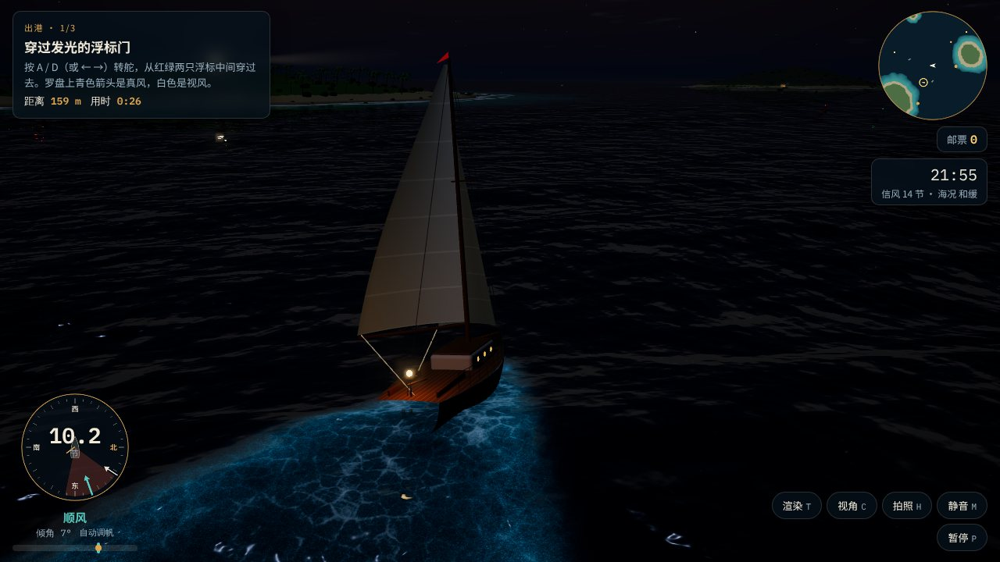
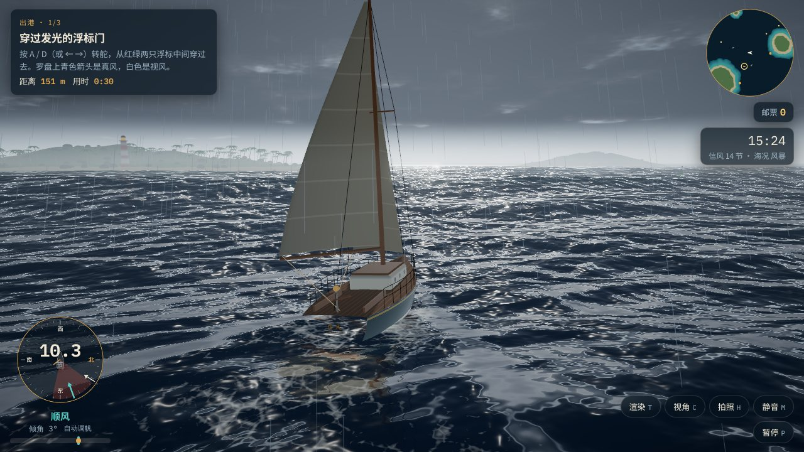
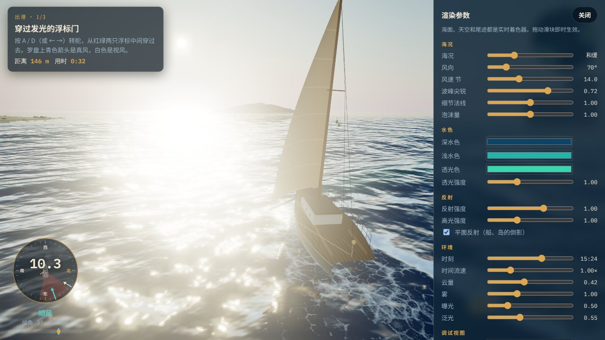
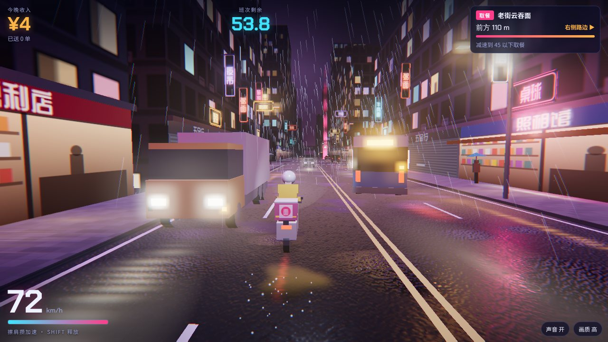
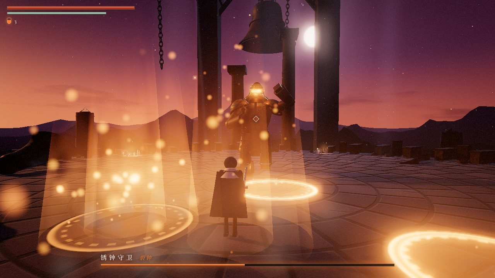
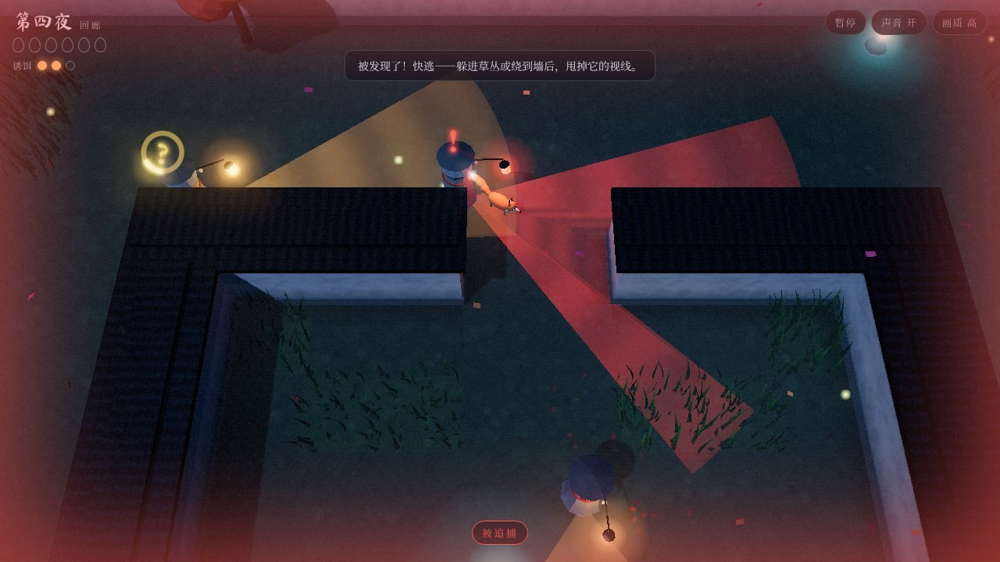

# Three.js 小游戏四款

四款浏览器 3D 游戏，每款就是一个 HTML 文件。模型、贴图、音效和音乐全部由代码生成，没有任何资源文件，只从 CDN 加载 three.js r170 和字体。

品类参考了 GitHub 上 Claude 游戏合集里最受欢迎的几款（见文末“来源”）。玩法是同一类，名字、角色、美术和关卡都是原创。

| 游戏 | 类型 | 一句话 |
|---|---|---|
| [信风 Windpost](games/windpost/) | 海上帆船 · 水体渲染 | 驾单桅邮船在热带群岛之间送信，从午后航行到星夜 |
| [霓虹送面 Neon Noodle Dash](games/neon-noodle/) | 城市车流驾驶 | 雨夜霓虹城里骑电驴送面，赶在汤凉之前送到 |
| [锈钟 Rustbell](games/rustbell/) | 魂类 Boss 战 | 废钟楼顶单挑铜锈满身的钟盔守卫 |
| [狐火 Foxfire](games/foxfire/) | 潜行 | 灵狐避开提灯石哨灵的视线，取回散落的狐火 |

## 信风 Windpost



- **玩法**：出港教学（3 道浮标门）→ 5 封限时送信（金、银、铜章）→ 环岛赛（6 道门计时）。海上还有漂流瓶可以捡。昼夜循环约 12 分钟，海况可以调到风暴，会下雨打雷。
- **航海**：区分真风和视风。航速按风向角变化，船头和风向夹角小于约 35° 就走不动（逆风停滞），横风最快。帆默认自动调；手动调对了会更快，换舷时帆杆会甩过去。
- **渲染**：
  - 14 个 Gerstner 波，CPU 和 GPU 用同一套波，船的浮力和画面里的浪对得上；
  - 逐像素法线，远处小浪按像素大小淡出，避免闪烁；
  - Fresnel 反射天空，太阳在海面上铺出一条闪光带；
  - 浅滩透出沙底和焦散，有岸线泡沫和浪尖透光；
  - 船尾迹单独存一张贴图，带开尔文 V 形波臂，夜里会发蓝光；
  - 船体按参数放样生成，帆随风鼓起。
- **渲染调参面板（按 T）**：约 20 个实时参数，包括海况、风向、波峰尖锐度、水色、泡沫、反射、时刻、雾、曝光、泛光。还能切调试视图：线框、法线、泡沫遮罩、尾迹图、水深、菲涅尔。
- **技术说明**：[games/windpost/WATER.md](games/windpost/WATER.md)，讲每个模块怎么做、参数作用、怎么搬到别的 Three.js 项目、性能分档和踩过的坑。
- **操作**：A/D 或 ←/→ 转舵，W/S 收放帆（E 恢复自动），Shift 辅助马达，拖动视角、滚轮缩放，C 切视角，H 拍照模式（隐藏界面），T 渲染面板，P 暂停，M 静音。手机上左下是舵盘，右侧是调帆滑杆和马达按钮。

| 浅滩与码头 | 夜光尾迹 |
|---|---|
|  |  |
| **风暴海况** | **渲染调参面板** |
|  |  |

## 霓虹送面 Neon Noodle Dash



- **玩法**：凌晨雨夜骑电驴送面。取餐和送达都要减速到 45 km/h 以下，有的客人在逆行车道那一侧。每送完一单加班次时间，时间用完就收工，按收入计分。
- **车流**：轿车、出租车、面包车、公交、货车。车辆会跟车，变道前约 1 秒打转向灯，刹车时亮刹车灯。按喇叭，前车会让道。
- **加分**：擦肩而过攒小费和加速，在逆行车道擦肩翻倍，连击最高 ×4。撞车会掉速，还洒掉 20% 的汤。
- **画面**：城市分段边骑边生成，有霓虹招牌、积水和湿路面反光、雨丝与水花、泛光、加速时的速度线。
- **操作**：A/D 转向，W 油门，S 刹车，Shift 或空格加速，H 喇叭，P 暂停，M 静音，Q 画质。手机上自动给油，屏幕下方有转向、喇叭、加速、刹车按钮。

## 锈钟 Rustbell



- **玩法**：黄昏时分的废钟楼顶单挑「锈钟守卫」。可选「从容」（伤害低、药多、出招慢）或「正常」难度。
- **Boss 招式**：横扫、重砸、跃击、钟鸣冲击波（翻滚穿过）、火柱，每招出手前都有地面预警和音效提示。打够伤害它会跪地，这时伤害 ×1.5。半血进入二阶段：钟盔裂开、咆哮击退、出招更快。
- **手感**：命中有短暂停顿、震屏和火花，刀光有拖尾，Boss 血条带延迟扣血。最后一击慢动作，巨钟坠落。
- **操作**：WASD 移动，Shift 疾跑，J 或左键轻击（三连），K 或右键重击，空格翻滚（翻滚瞬间无敌），R 喝药，Tab 切换锁定，P 暂停，M 静音。手机上左侧拖动移动，右侧有斩、劈、滚、药、锁按钮。

## 狐火 Foxfire



- **玩法**：共五关，取完一夜的狐火，月门开启后从门出去。全程不被发现可得三星。
- **石哨灵**：视野画在地面上，被墙挡住的部分会切掉，警觉度上升时从黄变橙再变红。行为分巡逻、起疑、追捕、搜索、返回几种状态。疾奔、诱饵和乌鸦叫声都会被它听见。
- **藏身**：草丛里很难被发现，站在灯下则老远就会被看见。诱饵可以把守卫引开，每拿一团狐火补 1 个，最多 3 个。
- **操作**：WASD 移动（脚步无声），按住 Shift 疾奔（会出声），E、空格或点地面扔诱饵，P 暂停，M 静音，Q 画质。手机上左下是摇杆，右侧有诱饵、疾奔按钮。

## 本地运行

游戏要联网加载 three.js 和字体。建议用任意静态服务器打开：

```bash
python3 -m http.server 8000
```

然后打开 <http://localhost:8000/>，首页就是游戏列表。

想放到网上的话，可以在仓库 Settings → Pages 里选 `main` 分支根目录。私有仓库要付费账号才能开 Pages。

## 目录

```
index.html                  游戏列表首页
games/<名字>/index.html     各游戏，单文件
games/windpost/WATER.md     水体与船只渲染说明
docs/screenshots/           截图
tools/play.cjs              无头浏览器试玩、截图
tools/artifact.cjs          独立网页 ↔ claude.ai Artifact 片段互转
tests/smoke.cjs             冒烟测试（加载 → 开始 → 操作 → 截图）
```

## 测试

每款游戏都暴露了 `window.__game.debug()`，返回当前状态（模式、分数、血量、位置、绘制调用数等），方便脚本检查。

```bash
npm install
npx playwright install chromium
node tools/play.cjs games/windpost/index.html out/windpost tests/smoke.cjs
```

`npm install` 之后，测试会用本地的 three.js 代替 CDN，断网也能跑。没有显卡的机器上 Chromium 用软件渲染，几帧每秒，只适合验证流程。

## 发布到 claude.ai

claude.ai 的 Artifact 会自己套上 `<html><head><body>` 骨架，所以发布的是骨架里面那段：

```bash
node tools/artifact.cjs unwrap games/windpost/index.html /tmp/windpost.html
```

## 来源

品类参考，只借鉴玩法类型：

| 本仓库 | 参考 | 出处与热度 |
|---|---|---|
| 霓虹送面 | Danfo Run（城市车流驾驶） | [ZeroLu/awesome-claude-games](https://github.com/ZeroLu/awesome-claude-games) 浏览量第一 |
| 狐火 | Saltline（潜行破坏） | 同上，编辑精选，浏览量第二 |
| 锈钟 | Evensong（魂类 Boss 战） | 同上，编辑精选 |
| 信风 | VibeSail、Halcyon（帆船、海岛） | [lappemic/awesome-ai-built-games](https://github.com/lappemic/awesome-ai-built-games) |

## 已知限制

- 开发环境没有显卡，只在软件渲染下跑通了流程，没测过真机帧率。每款都有画质开关，手机默认低画质或限制像素比。
- 音效和音乐都由 Web Audio 实时合成，只确认运行不报错，没有实际试听。
- 锈钟解除锁定后自由转视角，镜头可能穿进 Boss 或柱子。
- 信风正对下午的太阳时眩光较强，可以在渲染面板里调低“泛光”或“高光强度”。
